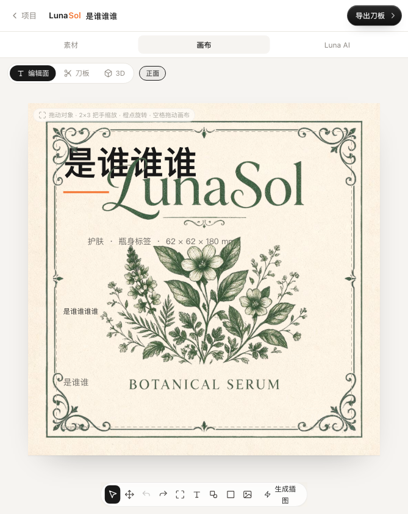
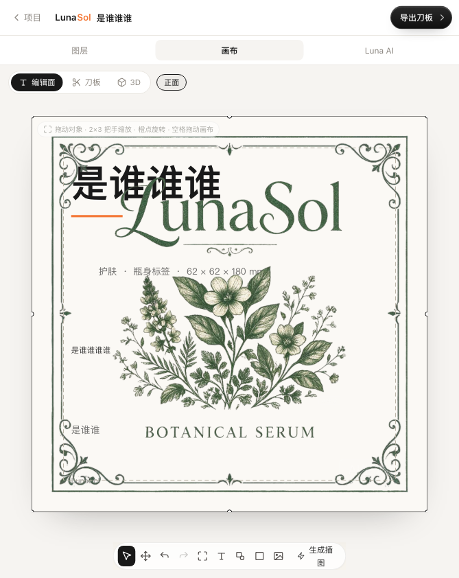
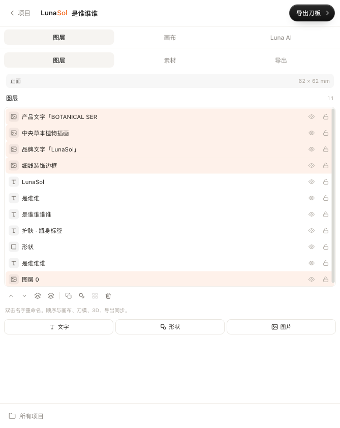
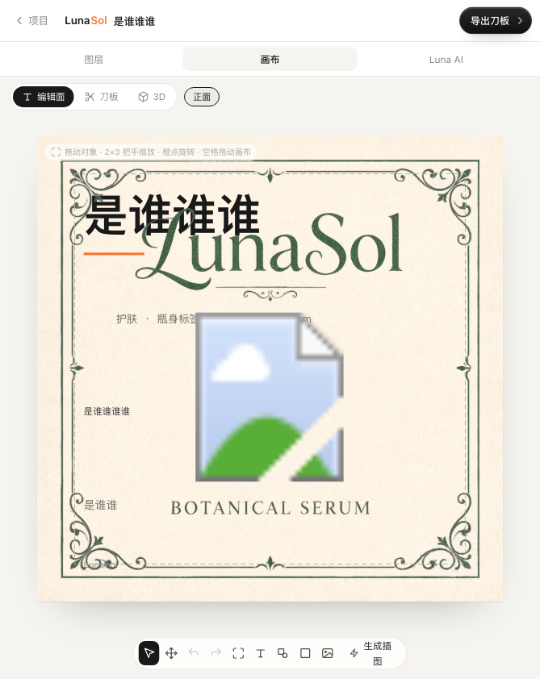
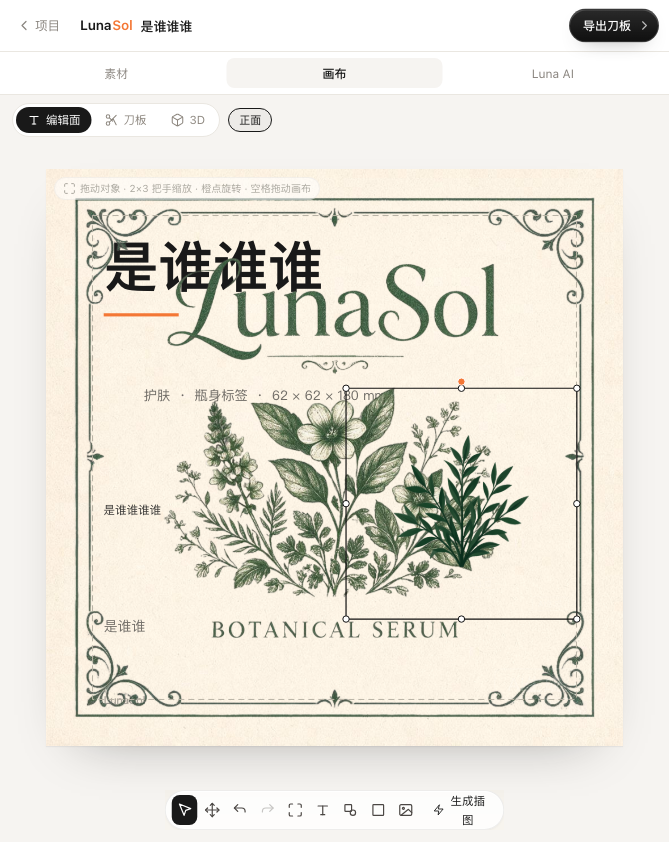
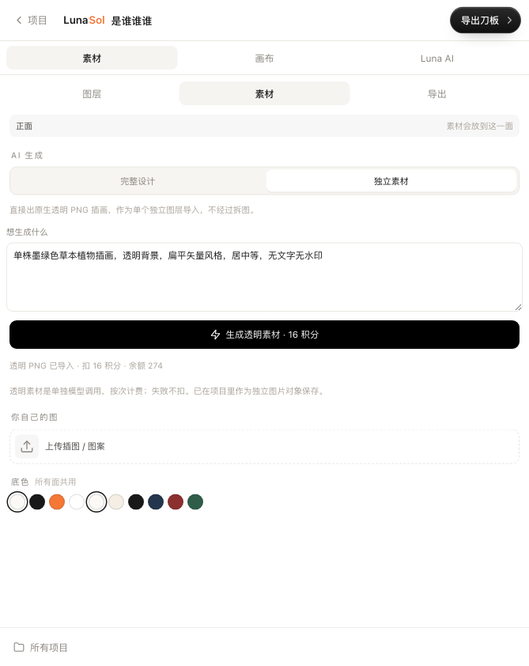

# LunaSol 2.0 · 阶段三：Seedream 图层拆分与自动还原

分支 `feature/lunasol-2-design-foundation`，阶段二基线 `c21fb24`。
本阶段在现有 `/studio` 包装设计画布上接入官方图层拆分、独立坐标还原、素材持久化和两套 AI 生成模式，没有另建模型接口，也没有在前端放置方舟密钥。

## 一、结论

核心链路已真实跑通：完整概念图 → 服务端计费 → 官方图层拆分 → 下载透明 PNG → 写素材库 → 解析 `bounding_box.absolute` / `z_index` → 导入 SVG 毫米画布 → 单层选择、移动、缩放、删除、显隐、撤销 → 刷新后图层与素材仍在 → 项目可保存。

唯一未满足的验收是「Seedream 5.5 本人」：

- 代码默认模型是 `doubao-seedream-5-5-261028`，请求已按 5.5 文档实现 `layer_decomposition_options`、`text_recognition`、最多 100 张（1 底图 + 99 图层）。
- 当前火山方舟账号 `2132613695` 未开通 Seedream 5.5。真实调用返回：`Your account 2132613695 has not activated the model doubao-seedream-5-5-261028`。服务端已自动退款，`lunasol_ai_jobs` 中 job `concept_mwqqcol0_wpe3rf` 状态 `refunded`。
- 为让阶段三链路可验收，云函数环境变量临时覆盖为 `SEEDREAM_55_MODEL=doubao-seedream-5-0-pro-260628`。5.0 Pro 与 5.5 共用同一个官方图层拆分协议，但上限 17 张、没有 `text_recognition` 富文本 OCR。
- 5.5 开通后，在云函数控制台删除 `SEEDREAM_55_MODEL` 变量即可回到代码默认的 5.5，无需改代码。

## 二、实现结构

### 1. 模型代理与鉴权

继续复用现有 CloudBase 云函数 `lunasol-ai`，前端只传档位/能力和 `X-LunaSol-Token`，真实模型 ID、`ARK_API_KEY` 只在云函数环境变量。

| 能力 | 路由 | 真实模型来源 |
| --- | --- | --- |
| 原图生成 | `POST /images/generations` | `imageRoute(flash/pro/gpt2-*)` |
| 完整概念图 / 独立透明素材 | `POST /studio/ai` | `SD55_MODEL`，默认 5.5，可环境变量灰度 |
| 图层拆分 | `POST /images/layer-split` | `LAYER_SPLIT_MODEL`，默认同 `SD55_MODEL` |
| 拆分图层读取 | `GET /assets/<id>` | 云函数从 `lunasol_assets` 取 data URL 返回 |

浏览器不接触 `ARK_API_KEY`，也不能传任意积分数。拆分费用由云函数按 `12 + 1 × max_images` 计算；概念图 20，透明素材 16。计费身份使用用户 CloudBase access token 调数据库 RPC，不信任前端 `X-CloudBase-Uid`。

### 2. 官方图层拆分请求

5.5 下实际 payload：

```json
{
  "model": "doubao-seedream-5-5-261028",
  "prompt": "拆分为底图、背景、插画、装饰图案、文字等可编辑图层",
  "image": "data:image/png;base64,...",
  "layer_decomposition": true,
  "layer_decomposition_options": { "max_images": 16, "text_recognition": true },
  "size": "auto",
  "response_format": "url"
}
```

关键约束已落到代码：

- `layer_decomposition_options` 只在模型名匹配 `seedream-5-5` 时发送；给 5.0 传会真实报错，已踩过并修掉。
- 拆分场景禁止传 `background`。
- `max_images` 含底图，默认 16，可选 12 / 16 / 20 / 30，不把 100 当默认。
- 5.0 Pro 上限 17，`max_images=min(请求值,17)`，费用按实际值计算，meta 记录 `requestedMax/modelMax`。
- `size` 拆分只允许 `1K / 1.5K / 2K / auto`。
- 上游 `url` 有效期 24 小时，云函数立即下载并持久化，不把临时 URL 落进项目。

### 3. 独立解析器

新增 `src/engine/seedreamLayers.ts`，React 不直接读原始模型响应。

- 明确类型：`ParsedLayer`、`ParsedSplit`、`LayerOcr`、`OcrRunStyle`、`LayerKind`。
- 底图识别：`z_index=0` 且无 `bounding_box`；也兼容没有底图的响应。
- 图层按 `z_index` 升序；读取 `name`、`description`、`size`、`output_format`、`background`、`bounding_box.absolute`、`text_recognition`。
- 资源兼容三种形态：`b64_json`、临时 `url`、服务端持久化后的 `assetUrl`（已补专项测试）。
- 异常进入 `issues`：缺 bbox、缺 size、越界框、空响应、资源缺失；缺 bbox 不会被随机摆放。
- 类型分类：`background / illustration / decorative / product / logo / text / unknown`，启发式结果带置信度，判断不了归 `unknown`，允许在属性面板手动改。

### 4. 坐标还原

新增 `src/engine/layerPlacement.ts`：

```
scaleX = targetWidth / baseImageWidth
scaleY = targetHeight / baseImageHeight
x = left * scaleX
y = top * scaleY
width = (right - left) * scaleX
height = (bottom - top) * scaleY
```

- `stretch` 严格使用上述双轴比例；`contain` / `cover` 统一走单一等比缩放，分别居中留白或裁切，并在结果里标记 `clipped`，不会偷偷拉伸素材。
- 目标画布尺寸使用当前包装面板的毫米宽高，不是未经确认的图片像素。
- 元素位置最终写回设计数据的百分比坐标，画布 SVG 使用毫米 viewBox；PNG 像素不会被当成毫米。
- 验收用例硬编码：原图 1000×1000，bbox `[200,100,600,500]`，目标 200×200mm，结果必须为 `x=40 y=20 w=80 h=80`。测试实际打印 `x=40.000 y=20.000 w=80.000 h=80.000`。

### 5. 导入工作台

新增 `src/studio/layerImport.ts`：

- 底图只创建 1 个 `background` 对象，放在最底层；不会和透明图层重复叠加。
- 透明图层按 bbox 落位、按 z 重排 `zIndex`；分配稳定 ID 并关联当前面板/面。
- OCR 结构足够完整时生成 SVG 文字对象，原 PNG 仍保留但 `visible:false`；低置信度只保留 PNG 并提示，不删除原图。
- 重复导入按 `importJob + layer key` 去重；返回 `imported / skipped / duplicates / warnings / ids`。
- 全部导入和仅导入所选都可用；一次导入只提交一条撤销历史。

### 6. 素材持久化

新增表与 RPC：

- `lunasol_ai_jobs`：`job_key` 幂等、真实成本、`charged/refunded/failed`、`balance_after`、provider/model/meta。
- `lunasol_assets`：素材 ID、MIME、像素宽高、字节数、来源模型、图层名、项目 ID、data URL、创建时间，RLS 只允许 owner 读写。
- `lunasol_ai_job_charge`：先扣 base 再扣 bonus，余额不足返回 `insufficient` 并把 job 标记失败；写积分明细。
- `lunasol_ai_job_refund`：只退一次，恢复 base/bonus，状态 `refunded`，写退款明细。
- `lunasol_asset_put` / `lunasol_asset_get`：写入本人素材；读取走 SECURITY DEFINER 能力 URL，不需要登录。

前端项目只保存 `https://.../assets/<id>`，不把几十张 Base64 塞进项目 JSON。独立素材模式也走同一张素材表，记录 `source=doubao-seedream-5-0-pro-260628-asset`。

索引与素材接口：

- 素材 ID 为 32 位 hex，接口只接受 16–64 位 hex。
- `Content-Type` 统一经过 `normalizeMime`，`png` 会输出 `image/png`，并带 `X-Content-Type-Options: nosniff` 和一年 immutable 缓存。
- 旧 4 条 MIME 为 `png` 的素材已回填数据库，5 条旧素材接口现均为 `image/png`（底图为 `image/jpeg`，实际也是 JPEG）。

## 三、两种 AI 模式

| 模式 | 行为 | 计费 |
| --- | --- | --- |
| 完整设计 | 先生成一张概念图，只预览不落图；用户确认后再拆 | 概念图 20；拆分 `12 + 1 × n` |
| 独立素材 | 官方透明背景输出，直接作为单个图片对象导入 | 16 |

两种模式在素材面板分为两个独立入口，不共用状态，也不把“拆图”与“直接生成素材”混为一谈。

独立素材模式在本轮修掉两个真实问题：

1. 只传 `background=transparent`，没有输入图，官方拒绝：`transparent background requires exactly one input image`。已改为服务端附带一张 1024×1024 透明 PNG 占位输入。
2. 512×512 透明占位图被官方判 `png: invalid format: too much pixel data`。改为 1024×1024 后成功；真实生成、导入、扣 16 积分、余额 274，素材表新增 `98d1e29bad224625884c83b641698087`（1024×1024、image/png、2,056,253 bytes）。

## 四、真实 API 测试

测试账号 `solyoungwork@gmail.com`，方舟账号 `2132613695`；测试项目 `st_mwnrmip8nebhl`，正面面板 62×62mm；本地 `vite preview` 4173。

| 项目 | 结果 | 证据 |
| --- | --- | --- |
| Seedream 5.5 真实调用 | 阻塞，已退款 | 返回账号未开通；job `concept_mwqqcol0_wpe3rf` 状态 `refunded`；UI 明确提示并显示退款 |
| 完整概念图（5.0 Pro） | 通过 | job `concept_mwqptuuk_5qd8po`，扣 20，余额 334 |
| 官方图层拆分（5.0 Pro） | 通过 | job `ls_mwqq0bnc_iubj8r4`，扣 28，余额 306；4 透明图层 + 1 底图 |
| 拆分参数错误退款 | 通过 | 5.0 误传 `layer_decomposition_options` 被上游拒绝；job `ls_mwqpv71r_sqoiuxd` 状态 `refunded`，余额回 306 |
| 透明 PNG | 通过 | 4 个图层均为 RGBA PNG；`/assets/<id>` 返回 `content-type: image/png`；`file` 确认例如 845×519 RGBA |
| 底图 | 通过 | z0，1024×1024，无 bbox；素材 `01974e0fb401459eb77f2db39cefab30` |
| bbox 还原 | 通过 | 4 个 bbox 映射到 62×62mm；边框 51,50→974,974；品牌字 215,158→803,364；插画 208,388→814,760；产品字 291,803→734,832 |
| z 顺序 | 通过 | 底图 z0，边框 z1，品牌字 z2，插画 z3，产品字 z4 |
| 导入全部 | 通过 | `已导入 5 个对象（含底图/OCR 文字）`，图层总数 11；底图在最底层 |
| 单层编辑 | 通过 | 选中边框隐藏后从画布消失；选中插画拖动后 bbox 右移；撤销恢复原位 |
| 刷新持久化 | 通过（修 MIME 后） | 重新打开项目，5 个素材全部正常显示；修复前透明层显示破图，修复后正常 |
| 底图单独隐藏 | 通过 | 隐藏底图后画布仅剩 4 个透明 `<image>`，底图 href 不在画布节点中，无二次叠加 |
| 项目保存 | 通过 | `lunasol_projects` 行 `2118714144680054784:st_mwnrmip8nebhl` 自动保存，11 图层 |
| 独立透明素材 | 通过 | job `asset_mwqqpgd6_je5a4c`，扣 16，余额 274；素材 `98d1e2...` 1024×1024 image/png；画布以 https 素材地址显示 |
| 独立素材失败退款 | 通过 | 缺输入图 / 512 图两次真实失败，job 均 `refunded`，没有重复扣费 |
| 1000px→200mm 自动化验收 | 通过 | `npm test` 打印 `x=40.000 y=20.000 w=80.000 h=80.000` |
| 真实 5.5 OCR | 未执行 | 5.5 未开通，无法获得 `text_recognition` 响应 |
| 5.5 99 图层上限 | 未执行 | 同上；当前 5.0 上限 17，实际只拆 5 张 |

## 五、本阶段修掉的真实缺陷

1. **上游字段丢弃**：原 `/images/generations` 代理只返回 `{ b64_json, url }`，`z_index/name/description/bounding_box/text_recognition` 全部丢失。已新增专用拆分路由，并完整透传。
2. **前端扣费可伪造**：原 `recordUsage(uid,cost)` 由浏览器传积分。已改为云函数预扣、幂等 job、失败/取消退款，前端只展示服务端返回的 `cost/balance`。
3. **5.0 与 5.5 参数不兼容**：5.0 收到 `layer_decomposition_options` 会 400。已按模型能力分流，5.0 不传 options、上限 17。
4. **临时 URL 直接进项目**：已改为下载后写素材表，项目只存 `/assets/<id>`。
5. **素材 MIME 错误**：上游 `output_format` 返回 `png`，原实现直接输出 `content-type: png`，刷新后浏览器把透明层当附件，画布只剩底图。已加 `normalizeMime`，修复版重新部署后 5 个素材均为合法图片 MIME。
6. **独立素材缺输入图**：`background=transparent` 必须恰好一张输入图。已加服务端 1024 透明占位图。
7. **独立素材项目体积**：原先把整张 Base64 写进设计 JSON。已改为云函数持久化后返回 `assetUrl`，前端优先引用 URL，失败才回退 data URL。

## 六、修改文件列表

新增：

| 文件 | 职责 |
| --- | --- |
| `src/engine/layerPlacement.ts` | bbox 校验、像素→毫米映射、contain/cover/stretch、验收自检 |
| `src/engine/seedreamLayers.ts` | 官方响应类型、底图/图层/OCR 解析、分类、容错 |
| `src/studio/layerImport.ts` | 拆图结果转设计元素、底图唯一、z 顺序、OCR 重建、重复导入去重 |
| `cloudbase/migrations/20261122010000_lunasol_layer_split.sql` | `lunasol_ai_jobs`、`lunasol_assets` 与 4 个 RPC |
| `docs/lunasol-2-stage3-layer-split.md` | 本报告 |

修改：

| 文件 | 关键改动 |
| --- | --- |
| `src/cloud/models.ts` | `LAYER_SPLIT`、`layerSplitCost`、`SEEDREAM55_COST=20`、`SEEDREAM55_ASSET_COST=16` |
| `src/cloud/sdk.ts` | 暴露 `getAccessToken`，新增 `cloudAccessToken()` |
| `src/engine/seedream.ts` | `postAI` 带 token/uid；新增 `callStudioAI`、`callLayerSplit`；素材返回 `assetId/assetUrl` |
| `src/studio/types.ts` | `ElLayerType`；`layerType/importJob/ocrText/ocrConfidence`；允许 https 素材与 6MB 内 data URL |
| `src/studio/DesignStage.tsx` | 双模式素材面板、概念图预览、拆图确认/取消、层数/OCR 选项、成本提示、图层列表、导入全部/所选、独立素材 URL 引用 |
| `src/studio/Inspector.tsx` | 素材类型手动修改、OCR 原图/文字切换 |
| `src/studio/editor.css` | 拆图与素材面板样式 |
| `tests/suite.ts` | 新增 7 条阶段三测试，含 1000×1000→200mm、contain/cover、解析器、导入、assetUrl-only、分类兜底 |
| `cloudfunctions/lunasol-ai/index.js` | 5.5/5.0 分流、拆图路由、服务端预扣/退款、素材读写、MIME 修复、透明占位输入、独立素材持久化 |

## 七、构建、测试与部署

- `npm test`：**99/99 通过**。
- `npm run typecheck`：通过。
- `npm run build`：成功，`✓ built in 3.18s`。
- `node --check cloudfunctions/lunasol-ai/index.js`：通过。
- 云函数 `lunasol-ai` 状态 `Active`；`/health` 返回 `layerSplitEnabled:true`、`seedream55Enabled:true`、`keyConfigured:true`。
- 数据库对象已创建：`lunasol_ai_jobs`、`lunasol_assets`，4 个 RPC 可用。
- 当前云函数环境变量：`SEEDREAM_55_MODEL=doubao-seedream-5-0-pro-260628`（灰度覆盖，非代码默认）。

## 八、还原截图

完整设计导入后、刷新后重新加载仍完整显示：



隐藏底图后只剩 4 个透明图层，证明底图与图层没有重复叠加：



拆图导入后的图层面板（11 层，底图在最底）：



MIME 修复前的刷新破图证据：



MIME 修复后刷新完整显示：


独立透明素材模式真实生成并导入、按素材 URL 渲染：



素材模式扣费结果（16 积分，余额 274）：



## 九、遗留与下一步

1. **5.5 开通**：需在方舟控制台「开通管理」开通 `Doubao-Seedream-5.5`。开通后删除云函数环境变量 `SEEDREAM_55_MODEL`，再跑一次真实拆图，重点验收 `text_recognition` 和 99 图层上限。
2. **OCR 未真实验收**：当前 5.0 不返回 OCR。解析器和文字重建已有单测，但不能算真实模型验收。
3. **导出内联**：SVG/PNG/PDF 导出时远程 `/assets/<id>` 尚未内联，跨域或离线查看可能缺图；下一阶段应导出前抓取转 data URL。
4. **迁移历史**：远端库对象已存在，但本次因安全策略使用 `allowDdlViaExecute` 执行，未写入远端 migration history；后续应按团队规范补审计记录。
5. **5.5 成本核算**：`12 + 1 × n` 与方舟真实账单尚未对账；5.5 开通后需要按实际调用量复核毛利。
6. **层数默认**：默认 16，允许 12/16/20/30；不把 100 当默认，避免无意义调用和费用。

本阶段到此停止，不继续做导出内联和 5.5 OCR 验收。
